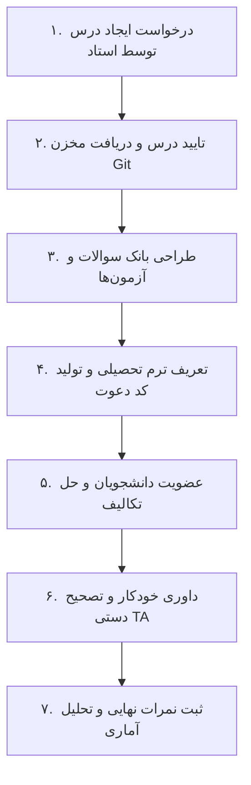

# معرفی کلی و فلسفه سامانه

سامانه جامع ارزیابی و یادگیری هوشمند، بستری مبتنی بر کد و داده‌های آموزشی است که به‌طور ویژه برای پیاده‌سازی **یادگیری تسلط‌محور (Mastery Learning)**، طراحی سوالات پارامتریک و تصحیح خودکار و آنی تکالیف و آزمون‌ها توسعه یافته است.

---

## ۱. تفاوت این سامانه با سامانه‌های مدیریت یادگیری سنتی (LMS)

در سامانه‌های سنتی (نظیر Moodle یا سیستم‌های مشابه):
- سوالات اغلب ایستا هستند (یک صورت سوال ثابت برای تمام دانشجویان).
- تقلب، کپی‌برداری و ارسال پاسخ میان دانشجویان به سادگی رخ می‌دهد.
- برای تمرین‌های کدنویسی یا محاسباتی، استاد یا دستیار آموزشی باید ساعت‌ها زمان صرف بررسی دستی خروجی‌ها کند.

در این سامانه:
1. **سوالات زنده و تصادفی (Randomized Questions)**:
   هر بار که دانشجو سوالی را باز می‌کند، کدهای پایتون در پشت صحنه مقادیر، معادلات، تصاویر، گراف‌ها و تست‌کیس‌های جدیدی تولید می‌کنند.
2. **داوری آنی در محیط امن (Sandboxed Autograding)**:
   کدهای دانشجویان (در زبان‌های پایتون، C، C++، جاوا، R و...) درون کانتینرهای امن ایزوله اجرا و در چند ثانیه بر اساس تست‌کیس‌های آزمایشی و مخفی نمره‌دهی می‌شوند.
3. **تسلط ۱۰۰ درصدی بر مفاهیم**:
   به جای اینکه دانشجو بعد از یک پاسخ اشتباه نمره صفر بگیرد و پرونده بسته شود، می‌تواند نمونه جدیدی از همان سوال را حل کرده و با جبران نمره، مفهوم علمی را به شکل اصولی بیاموزد.

---

## ۲. نقش‌ها و دسترسی‌ها در سامانه

| نقش | دسترسی‌ها و وظایف |
| :--- | :--- |
| **مدرس / طراح درس (Instructor)** | طراحی سوالات، ایجاد آزمون‌ها و تکالیف، تنظیم مهلت‌ها، انتشار نمرات و مدیریت دسترسی‌ها |
| **دستیار آموزشی (TA)** | تصحیح دستی سوالات تشریحی، ثبت بازخورد با روبریم، بررسی اعتراضات و کمک به دانشجویان |
| **دانشجو / فراگیر (Student)** | حل تکالیف، شرکت در آزمون‌های کلاسی و نهایی، مشاهده بلادرنگ نمرات و بازخوردهای تشخیصی |

---

## ۳. چرخه کاری یک درس (Course Lifecycle)

