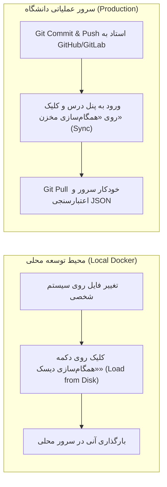

# همگام‌سازی، چرخه گیت و اصلاح نمرات (Git & Disk Sync)

تمام محتوای دروس، سوالات و تنظیمات آزمون‌ها فایل‌محور هستند. مدرسان می‌توانند بدون نیاز به فرم‌های کند تحت وب، از ابزارهای حرفه‌ای نظیر VS Code، Git و اسکریپت‌های پایتون برای تولید انبوه سوالات استفاده کرده و آن را با سامانه همگام‌سازی نمایند.

---

## ۱. تفاوت همگام‌سازی محلی (Local) و عملیاتی (Production)

### ۱.۱. همگام‌سازی در محیط توسعه محلی:
- هر زمان که فایل‌های `info.json`، `infoAssessment.json` یا `infoCourse.json` را تغییر می‌دهید، کافی است در نوار بالای سامانه روی دکمه سبز رنگ **«همگام‌سازی دیسک»** کلیک کنید.
- تغییرات فایل‌های پایتون (`server.py`) و کدهای HTML فرانت‌اند نیازی به همگام‌سازی دیسک ندارند و با یک رفرش ساده مرورگر بارگذاری می‌شوند.

### ۱.۲. همگام‌سازی در سرور دانشگاه:
- در سرور اصلی، درس به مخزن Git متصل است. پس از ارسال کدهای جدید، استاد به تب **Course Admin -> Sync** مراجعه کرده و دکمه **«Pull from remote git repository»** را می‌زند.

---

## ۲. ویرایشگر درون‌مرورگری (In-browser File Editor)

اگر به Git مسلط نیستید یا نیاز به اصلاح فوری یک خطای املایی در حین کلاس دارید:
1. در پنل مدیریت درس، به زبانه **Files** بروید.
2. درخت پوشه‌ها و فایل‌های درس را باز کنید.
3. فایل مورد نظر را باز کرده، تغییرات را اعمال نموده و روی دکمه **Save** کلیک کنید.
4. سامانه تغییرات را مستقیماً ذخیره کرده و به عنوان یک کامیت Git ثبت می‌نماید.

---

## ۳. عیب‌یابی خطاهای اعتبارسنجی (Schema Validation Errors)

هنگام همگام‌سازی، موتور سامانه تمام فایل‌های JSON را بر اساس ساختار استاندارد (Zod Schema) اعتبارسنجی می‌کند:
- **کامای اضافی در انتهای آبجکت JSON:** رایج‌ترین خطایی که باعث توقف همگام‌سازی می‌شود.
- **UUID تکراری:** هر سوال یا آزمون باید دارای UUID منحصر‌به‌فرد باشد. اگر سوالی را کپی می‌کنید، حتماً یک UUID جدید برای آن تولید نمایید (تولید با دستور `uuidgen` در ترمینال یا ابزارهای آنلاین).
- **فقدان کلیدهای الزامی:** مانند فراموش کردن `title`، `type` یا ارجاع به یک سوال که وجود ندارد.

> [!NOTE]
> در صورت بروز خطا، صفحه Sync خطوط دقیق و نام فایل خطا را به رنگ قرمز نمایش داده و نسخه قبلی را حفظ می‌کند تا هیچ کلاسی دچار اختلال نشود.

---

## ۴. تغییر سوالات در حین برگزاری آزمون و تصحیح مجدد (Regrading)

اگر در حین آزمون متوجه شدید که پاسخ کلید یک سوال اشتباه تعریف شده یا در تست‌کیس‌های کدنویسی باگی وجود دارد:

1. **آرامش خود را حفظ کنید:** ویرایش فایل و همگام‌سازی مجدد، آزمون‌های فعال دانشجویان را قطع نمی‌کند.
2. **اصلاح کلید سوال:** فایل `server.py` یا `question.html` را ویرایش و همگام‌سازی کنید.
3. **تصحیح مجدد خودکار (Regrade):**
   - به صفحه مدیریت آن آزمون مراجعه کنید.
   - در تب **Students** یا **Log**، دکمه **«Regrade all submissions»** را بزنید.
   - سامانه تمامی پاسخ‌های قبلی دانشجویان را مجدداً با کلید و تست‌های اصلاح‌شده داوری کرده و نمرات جدید را بدون نیاز به ورود دستی جایگزین می‌کند.
