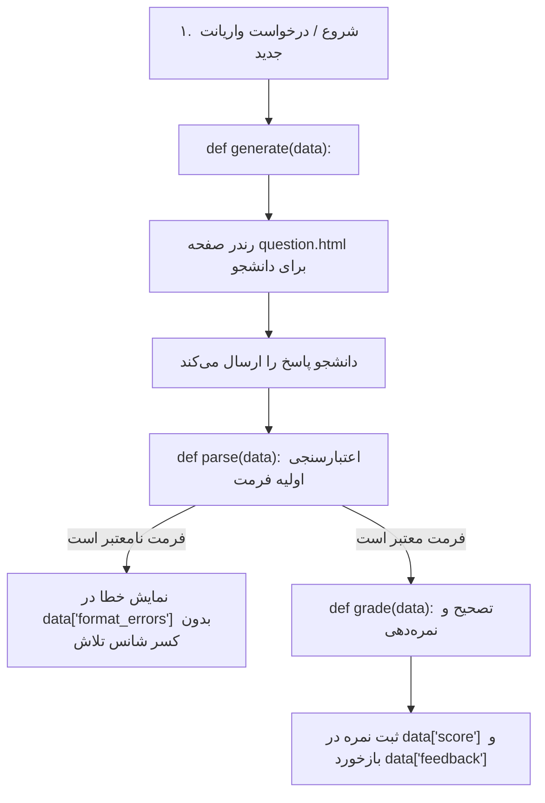

# اصول طراحی سوالات و کدنویسی سرور (`question.html` و `server.py`)

در سامane ارزیابی هوشمند، هر سوال یک واحد مستقل و نسخه‌پذیر است که درون پوشه‌ای مجزا در مسیر `questions/` قرار می‌گیرد.

---

## ۱. چرخه حیات کامل یک سوال (Question Lifecycle)

هنگامی که فراگیر یک سوال را مشاهده می‌کند، پاسخی وارد کرده و آن را ارسال می‌کند، موتور ارزیابی توابع مشخصی را در فایل `server.py` به ترتیب زیر فراخوانی می‌کند:



---

## ۲. ساختار سه‌پنلی استاندارد سوال در `question.html`

طراحی مدرن سوالات بر پایه معماری ۳ پنلی (Three-Panel Layout) استوار است که جداسازی منطقی صورت سوال، بازخورد ارسال، و کلید پاسخ تشریحی را فراهم می‌کند:

```html
<!-- ۱. پنل صورت سوال و المان‌های ورودی -->
<pl-question-panel>
  <p>تابع <code>solve(x)</code> را به گونه‌ای پیاده‌سازی کنید که ریشه معادله زیر را بیابد:</p>
  <pl-code language="python">f(x) = x**3 - {{params.c}}</pl-code>
  
  <p>کد پاسخ خود را در کادر زیر وارد نمایید:</p>
  <pl-file-editor file-name="solution.py" ace-mode="ace/mode/python"></pl-file-editor>
</pl-question-panel>

<!-- ۲. پنل نحوه نمایش ارسال‌های دانشجو در تاریخچه تلاش‌ها -->
<pl-submission-panel>
  <pl-file-preview></pl-file-preview>
  <pl-external-grader-results></pl-external-grader-results>
</pl-submission-panel>

<!-- ۳. پنل پاسخ تشریحی و راهنمای حل مرجع (نمایش پس از موعد مقرر یا آزمون) -->
<pl-answer-panel>
  <div class="card border-info">
    <div class="card-header bg-info-subtle fw-bold">روش حل گام‌به‌گام و کد مرجع:</div>
    <div class="card-body">
      <p>با استفاده از روش نیوتن-رافسون با گام تکرار:</p>
      <pl-code language="python">
def solve(x_init):
    # کد مرجع استاد
    return {{correct_answers.root}}
      </pl-code>
    </div>
  </div>
</pl-answer-panel>
```

---

## ۳. کالبدشکافی فایل پیکربندی سوال (`info.json`)

هر سوال دارای یک فایل `info.json` در پوشه اختصاصی خود است که ویژگی‌های پایه‌ای، متاداده‌ها و نحوه تصحیح را برای سیستم مشخص می‌سازد:

```json
{
  "uuid": "8b52e391-7f9a-4c22-b5e1-80a1c6e12903",
  "title": "محاسبه ریشه به روش نیوتن-رافسون",
  "topic": "NumericalMethods",
  "tags": ["python", "algorithms", "autograded"],
  "type": "v3",
  "singleVariant": false,
  "gradingMethod": "External",
  "partialCredit": true,
  "externalGradingOptions": {
    "image": "prairielearn/grader-python-pytest:lite",
    "entrypoint": "/grader/run.sh",
    "timeout": 30
  },
  "options": {
    "showCorrectAnswer": true
  }
}
```

### فیلدهای کلیدی `info.json`:
- **`uuid`**: شناسه یکتای جهانی (v4 UUID) جهت ردیابی و همگام‌سازی سوال در پایگاه‌داده.
- **`title`**: عنوان کامل و فارسی سوال که در داشبورد و آزمون نمایش داده می‌شود.
- **`topic`**: مبحث سوال (باید در `infoCourse.json` زیرمجموعه `topics` تعریف شده باشد).
- **`tags`**: برچسب‌های طبقه‌بندی (مانند زبان برنامه‌نویسی، درجه سختی و نوع سوال).
- **`type`**: ساختار نسل سوم پلتفرم که همواره مقدار `"v3"` است (پشتیبانی کامل از المان‌های `pl-*`).
- **`singleVariant`**: در صورتی که `true` باشد، برای تمام دانشجویان یک نمونه یکسان تولید می‌شود. مقدار `false` به معنای اجرای `server.py` و تولید نمونه تصادفی به ازای هر دانشجو است.
- **`gradingMethod`**: نحوه نمره‌دهی:
  - `"Internal"`: تصحیح درون سرور اصلی با توابع پایتونی `server.py` یا المان‌های داخلی.
  - `"External"`: ارسال کد به کانتینر ایزوله Docker جهت اجرای تست‌ها، کامپایل و داوری امن.
  - `"Manual"`: تصحیح دستی توسط استاد یا دستیاران آموزشی با بارم‌بندی (Rubric).
- **`partialCredit`**: فعال بودن نمره‌دهی جزئی برای تست‌ها و بخش‌های مختلف سوال.

---

## ۴. کالبدشکافی آبجکت داده‌ها (`data`) در پایتون

آبجکت `data` یک دیکشنری پایتون استاندارد است که میان تمام توابع چرخه حیات به اشتراک گذاشته می‌شود:

```python
data = {
    "params": {},            # متغیرهای تصادفی تولیدشده برای نمایش در صورت سوال
    "correct_answers": {},   # کلید و پاسخ‌های صحیح سوال
    "submitted_answers": {}, # پاسخ‌های ارسالی دانشجو پس از parse
    "raw_submitted_answers": {}, # رشته‌های خام ورودی کاربر از مرورگر
    "format_errors": {},     # خطاهای اعتبارسنجی فرمت ورودی (مانند غلط املایی یا سینتکس)
    "partial_scores": {},    # نمره هر بخش از سوال (بین 0.0 تا 1.0)
    "score": 0.0,            # نمره کل نهایی سوال (بین 0.0 تا 1.0)
    "feedback": {},          # پیام‌ها و راهنمایی‌های تشخیصی برای دانشجو
    "options": {},           # تنظیمات و آپشن‌های المان‌های HTML
    "variant_seed": 12345,   # بذر تصادفی‌سازی (جهت بازتولید دقیق همین نمونه)
}
```

---

## ۳. توابع چرخه حیات در `server.py`

### ۳.۱. تابع `generate(data)`
وظیفه این تابع تولید اعداد تصادفی، انتخاب سناریوها، محاسبه پاسخ‌های مرجع و رسم شکل‌های پویا است:

```python
import random
import numpy as np

def generate(data):
    # ۱. تولید پارامترهای تصادفی
    m = random.randint(2, 10)       # جرم بر حسب کیلوگرم
    v = random.randint(3, 15)       # سرعت بر حسب متر بر ثانیه
    
    # ۲. محاسبه پاسخ صحیح
    kinetic_energy = 0.5 * m * (v ** 2)
    
    # ۳. ذخیره در آبجکت data
    data["params"]["mass"] = m
    data["params"]["velocity"] = v
    data["correct_answers"]["ke"] = kinetic_energy
```

### ۳.۲. تابع `parse(data)` (اعتبارسنجی فرمت ورودی)
اگر دانشجو در کادر یک فرمول جبری، پرانتز نبسته یا کاراکتر غیرمجاز وارد کند، تابع `parse` فعال شده و پیام خطا را در `data["format_errors"]` قرار می‌دهد. **در این حالت، هیچ فرصتی از تعداد تلاش‌های مجاز دانشجو کسر نمی‌شود:**

```python
def parse(data):
    user_input = data["raw_submitted_answers"].get("ke", "")
    
    # بررسی خالی بودن یا مقادیر منفی غیرمنطقی
    try:
        val = float(user_input)
        if val < 0:
            data["format_errors"]["ke"] = "انرژی جنبشی نمی‌تواند یک مقدار منفی باشد."
    except ValueError:
        data["format_errors"]["ke"] = "لطفاً صرفاً یک مقدار عددی معتبر وارد نمایید."
```

### ۳.۳. تابع `grade(data)` (نمره‌دهی سفارشی و پیشرفته)
برای سوالاتی که پاسخ چندگانه دارند یا نیازمند نمره‌دهی جزئی (Partial Credit) و بازخورد ویژه هستند:

```python
import prairielearn as pl

def grade(data):
    # دریافت پاسخ دانشجو و پاسخ مرجع
    ans = data["submitted_answers"].get("ke", None)
    true_ans = data["correct_answers"]["ke"]
    
    if ans is None:
        data["score"] = 0.0
        return
        
    # محاسبه خطای نسبی
    rel_error = abs(ans - true_ans) / true_ans
    
    if rel_error < 0.01:      # خطای کمتر از ۱ درصد -> نمره کامل
        data["score"] = 1.0
        data["feedback"]["ke"] = "آفرین! پاسخ شما با دقت عالی محاسبه شده است."
    elif rel_error < 0.05:    # خطای کمتر از ۵ درصد -> نمره ۸۰٪
        data["score"] = 0.8
        data["feedback"]["ke"] = "پاسخ نزدیک است، اما دقت اعشاری محاسبات را بیشتر کنید."
    else:
        data["score"] = 0.0
        data["feedback"]["ke"] = "پاسخ نادرست است. فرمول رابطه انرژی جنبشی: K = 1/2 * m * v^2"
```

---

## ۴. رسم تصاویر و نمودارهای پویا با Matplotlib

اساتید می‌توانند به ازای پارامترهای هر دانشجو، دیاگرام، سیگنال یا شکل هندسی اختصاصی رسم کنند:

```python
import io
import matplotlib.pyplot as plt

def generate(data):
    freq = random.randint(1, 5)
    data["params"]["freq"] = freq
    
    # رسم نمودار سینوسی
    t = np.linspace(0, 2, 500)
    y = np.sin(2 * np.pi * freq * t)
    
    fig, ax = plt.subplots(figsize=(6, 3))
    ax.plot(t, y, 'b-', lw=2)
    ax.set_title(f"موج سینوسی با بسامد {freq} هرتز")
    ax.set_xlabel("زمان (ثانیه)")
    ax.grid(True)
    
    # ذخیره در بافر تصویر
    buf = io.BytesIO()
    plt.savefig(buf, format="png", bbox_inches="tight")
    plt.close(fig)
    
    # ارسال تصویر به تگ pl-figure
    data["params"]["sine_plot"] = pl.to_json(buf)
```

در فایل `question.html`:
```html
<p>با توجه به نمودار موج سینوسی زیر، بسامد آن را تعیین کنید:</p>
<pl-figure file-name="sine_plot.png" type="dynamic"></pl-figure>
```

---

## ۵. استفاده از کدهای مشترک در `serverFilesCourse/`

اگر توابع محاسباتی مشترک (مانند حل معادلات دیفرانسیل، جداول ترمودینامیکی یا ماتریس‌ها) دارید، کافی است فایل‌های پایتون را در پوشه `serverFilesCourse/` در ریشه درس قرار دهید. موتور سامانه این مسیر را به صورت خودکار به `sys.path` اضافه می‌کند:

```python
# در فایل questions/my_question/server.py
import my_physics_helpers as mph

def generate(data):
    mph.calculate_planetary_orbit(data)
```
