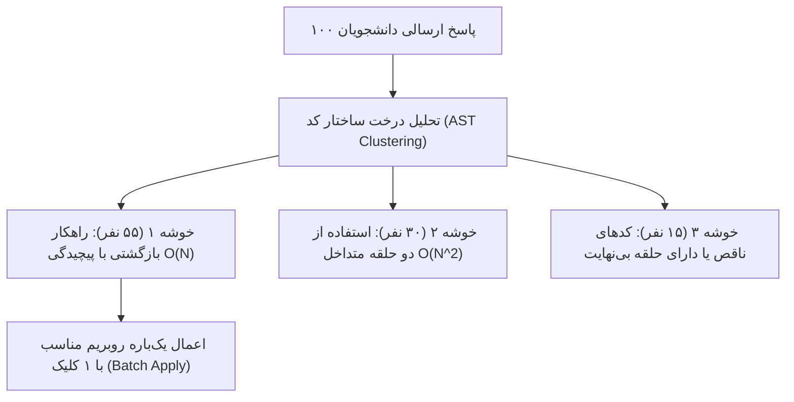

# دستیار هوش مصنوعی در تصحیح و خوشه‌بندی پاسخ‌ها (AI Grading)

سامانه ارزیابی هوشمند مجهز به دستیار هوش مصنوعی است که به عنوان کمک‌یار مصحح انسانی عمل کرده و سرعت و دقت نمره‌دهی را ارتقا می‌بخشد.

---

## ۱. تصحیح خوشه‌ای مبتنی بر درخت نحو (AST Clustering)

هوش مصنوعی پاسخ‌های کدهای ارسالی یا متون تشریحی را تحلیل کرده و پاسخ‌های با رویکرد مشابه را در خوشه‌ها (Clusters) دسته‌بندی می‌کند:

### مزیت بزرگ تصحیح خوشه‌ای:
به جای این که مصحح یک خطای یکسان را ۵۵ بار تکرار و ثبت کند، روبریم مناسب را برای خوشه ۱ انتخاب کرده و با یک کلیک روی کل اعضای خوشه اعمال می‌نماید، ضمن این که امکان بازبینی تک‌به‌تک هر برگه نیز حفظ می‌شود.

---

## ۲. اصل حضور و تایید انسان در چرخه تصمیم‌گیری (Human-in-the-Loop)

- هوش مصنوعی هرگز نمره قطعی را بدون نظارت در کارنامه ثبت نمی‌کند.
- تمام نمرات پیشنهادی و کامنت‌های تولیدشده با رنگ زرد یا برچسب «پیشنهاد هوش مصنوعی» نمایش داده می‌شوند.
- دستیار آموزشی یا استاد با فشردن کلید **Accept** یا ویرایش دستی نمره، مسئولیت صحت ارزیابی را بر عهده می‌گیرند.

---

## ۳. محرمانگی و امنیت داده‌های دانشگاهی

- اطلاعات هویتی دانشجویان (نام، ایمیل، شماره دانشجویی) پیش از ارسال کدهای پروژه به موتور پردازش زبانی کاملاً ماسک می‌شوند.
- داده‌ها برای آموزش عمومی مدل‌های تجاری استفاده نمی‌شوند و تحت پروتکل‌های حفاظت از داده‌های دانشگاهی پردازش می‌گردند.
