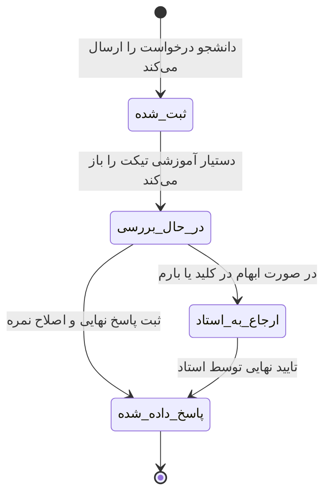

# مدیریت اعتراضات، بازبینی و تجدیدنظر نمرات (Regrading & Appeals)

پس از انتشار کارنامه آزمون‌ها و تکالیف، فراگیران می‌توانند در یک بازه زمانی مشخص، درخواست بازبینی یا اعتراض خود را روی یک سوال خاص ثبت کنند.

---

## ۱. ضوابط و پنجره زمانی اعتراضات (Appeals Policy)

برای جلوگیری از ارسال تیکت‌های نامربوط یا وقت‌گیر:
1. **پنجره زمانی محدود:** دانشجویان معمولاً تا ۷۲ ساعت پس از اعلام نتایج اولیه فرصت ثبت تیکت بازبینی دارند. پس از اتمام ددلاین، فرم اعتراض خودکار قفل می‌شود.
2. **الزام به ارجاع صریح به بندهای روبریم:** دانشجو باید دقیقاً مشخص کند به کدام بند از بارم‌بندی اعتراض دارد (مثلاً: *«اعتراض به کسر نمره در بند ۲ مربوط به شرط مرزی»*). درخواست‌های کلی مانند *«من خیلی زحمت کشیدم»* قابل ثبت نیستند.
3. **هشدار امکان کسر نمره:** به دانشجو صریحاً اعلام می‌شود که بازبینی کل پاسخ را شامل می‌شود؛ لذا اگر مصحح در بازبینی متوجه خطای دیگری شود که قبلاً ندیده گرفته شده، امکان کاهش نمره نیز وجود دارد.

---

## ۲. چرخه عمر تیکت اعتراض (Ticket Lifecycle)

---

## ۳. یادداشت‌های داخلی مصححان (Internal Staff Notes)

در پنل رسیدگی به اعتراضات، دستیاران آموزشی می‌توانند از تب **«یادداشت داخلی» (Internal Note)** استفاده کنند:
- این یادداشت‌ها صرفاً برای استاد درس و سایر TAها قابل مشاهده است.
- از این قابلیت برای هماهنگی پیرامون مواردی مثل: *«من فکر می‌کنم راهکار این دانشجو هرچند نامتعارف است اما درست است، نظر استاد چیست؟»* استفاده می‌شود.
- پس از توافق کادر آموزشی، پاسخ رسمی ثبت شده و دانشجو ایمیل اطلاع‌رسانی دریافت خواهد کرد.
