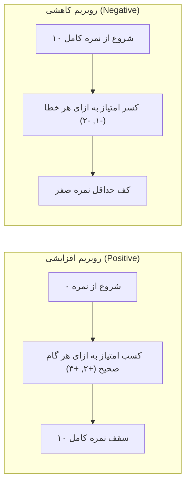

# بارم‌بندی استاندارد با روبریم (Rubrics)

روبریم (معیار بارم‌بندی) ابزاری است که خطاهای رایج و دستاوردهای کلیدی پاسخ دانشجویان را به آیتم‌های با بارم مشخص تبدیل می‌کند تا عدالت در نمره‌دهی حفظ شده و بازخوردها یکدست باشند.

---

## ۱. تفکیک دو مدل بارم‌بندی: افزایشی در برابر کاهشی



### ۱.۱. مدل افزایشی (Positive Grading):
- نمره اولیه صفر است.
- به ازای اثبات قضیه، نوشتن فرمول صحیح یا تحلیل درست، امتیاز افزوده می‌شود (`+2`, `+5`).
- مناسب برای مسائل ریاضی، فیزیک نظری و پرسش‌های چندمرحله‌ای.

### ۱.۲. مدل کاهشی (Negative Grading):
- نمره اولیه بر روی سقف بارم (مثلاً ۱۰ نمره) قرار دارد.
- به ازای هر باگ، عدم رعایت اصول تمیزی کد یا فراموشی حالت‌های مرزی، نمره کسر می‌شود (`-1`, `-3`).
- بسیار کارآمد و سریع برای پروژه‌های نرم‌افزاری و مهندسی.

---

## ۲. کف و سقف نمره (Floor & Ceiling)

- **کف نمره (Floor):** به صورت پیش‌فرض، حتی در صورت تعدد خطاهای کاهشی، نمره سوال از صفر کمتر نخواهد شد، مگر اینکه گزینه نمره منفی در تنظیمات سوال قفل نشده باشد.
- **سقف نمره تشویقی (Ceiling & Extra Credit):** می‌توان آیتم‌های تشویقی (مثلاً `+2` برای پیاده‌سازی الگوریتم با پیچیدگی بهتر از حد انتظار) تعریف کرد. در صورتی که گزینه نمره اضافه فعال باشد، دانشجو می‌تواند نمره‌ای فراتر از ۱۰۰٪ کسب کند.

---

## ۳. مدیریت آیتم‌های پویا در حین تصحیح (Dynamic Rubrics)

اگر در حین بررسی برگه چهلم متوجه خطایی شدید که در ۳۹ برگه قبلی به آن توجه نکرده بودید:
1. آیتم جدیدی به روبریم اضافه کنید (مثلاً: *-۲ نمره برای عدم اعتبارسنجی آرایه خالی*).
2. با هماهنگی سر‌دستیار آموزشی (Head TA)، فیلتر پنل را روی برگه‌های قبلی تنظیم کرده و آن آیتم را در صورت وجود روی موارد پیشین نیز اعمال نمایید تا عدالت کامل رعایت شود.

---

## ۴. نمونه بازخورد استاندارد Markdown برای دانشجو

دستیاران آموزشی می‌توانند در کنار انتخاب آیتم‌های روبریم، توضیحات تفصیلی را در قالب Markdown تایپ نمایند:

```markdown
### بازخورد دستیار آموزشی
پاسخ شما برای حالت‌های متقارن الگوریتم درست است، اما در مدیریت آرایه خالی برنامه دچار خطا می‌شود:

```python
# کد شما در این بخش خطای IndexError تولید می‌کند:
if arr[0] == target:
    return True
```

**پیشنهاد:** قبل از دسترسی به اندیس اول، شرط طول آرایه را بررسی کنید:
`if not arr: return False`
```
