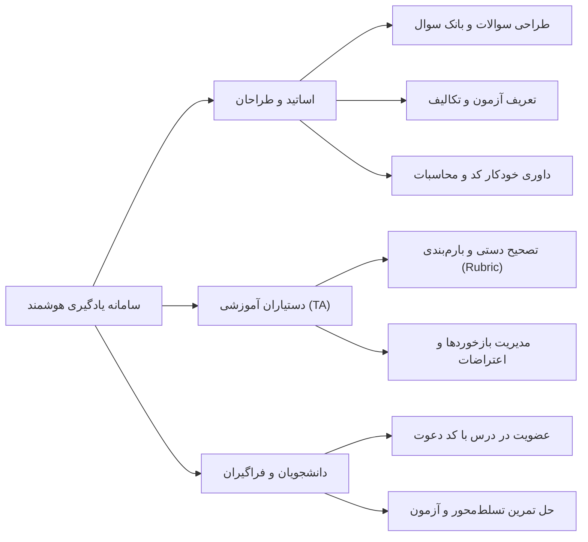

# راهنمای جامع سامانه ارزیابی و یادگیری هوشمند
> **ویژه اساتید، مدرسان، دستیاران آموزشی (TA) و دانشجویان / فراگیران**

این پایگاه دانش و مستندات، راهنمای گام‌به‌گام کار با سامانه ارزیابی و آموزش تسلط‌محور است. هدف این راهنما، توانمندسازی مدرسان در طراحی و مدیریت دوره‌ها، تسریع فرایند داوری سوالات توسط دستیاران آموزشی و راهنمایی فراگیران در نحوه کار با سامانه است.

---

## 📌 دسترسی سریع به بخش‌ها

### ۱. شروع به کار و مفاهیم اولیه
- [معرفی سامانه و فلسفه یادگیری تسلط‌محور](01-getting-started/overview.md)
- [حساب کاربری، ثبت‌نام و ورود با رمز عبور](01-getting-started/account-and-login.md)
- [راهنمای درخواست ایجاد درس جدید](01-getting-started/course-request.md)

### ۲. راهنمای اساتید و طراحان دوره
- [ساختار پوشه‌ها و فایل‌های دوره](02-instructor-guide/course-structure.md)
- [پیکربندی درس و مشخصات ترم (`infoCourse.json` و `infoCourseInstance.json`)](02-instructor-guide/course-configuration.md)
- [اصول طراحی سوالات، کدهای سرور و رابط کاربری (`question.html` و `server.py`)](02-instructor-guide/question-authoring.md)
- [المان‌ها و تگ‌های تعاملی سوالات (چندگزینه‌ای، عددی، ماتریسی، چک‌باکس و فرمول)](02-instructor-guide/question-elements.md)
- [تعریف آزمون‌ها، تکالیف و کوییزها (`infoAssessment.json`)](02-instructor-guide/assessment-setup.md)
- [اصول یادگیری تسلط‌محور (Mastery Learning)، نمره‌دهی تصادفی و تلاش‌های مجدد](02-instructor-guide/mastery-learning.md)
- [مدیریت دانشجویان، کدهای ثبت‌نام و سطوح دسترسی](02-instructor-guide/student-management.md)
- [دفترچه نمرات، تحلیل عملکرد کلاسی و خروجی اکسل/CSV](02-instructor-guide/gradebook-and-analytics.md)

### ۳. داوری خودکار و سوالات برنامه‌نویسی
- [داوری خودکار سوالات پایتون (Python Autograder)](03-autograding-and-code/python-autograder.md)
- [داوری خودکار سوالات زبان‌های C و ++C](03-autograding-and-code/c-cpp-autograder.md)
- [داوری خودکار سوالات جاوا با JUnit](03-autograding-and-code/java-autograder.md)
- [میز کارهای ابری تعاملی (Workspaces: VS Code و Jupyter Notebook)](03-autograding-and-code/workspaces.md)

### ۴. راهنمای دستیاران آموزشی (TA) و تصحیح
- [نحوه تصحیح دستی سوالات تشریحی و پروژه‌ها](04-ta-and-grading/manual-grading.md)
- [بارم‌بندی استاندارد و ثبت بازخورد با روبریم (Rubrics)](04-ta-and-grading/rubrics.md)
- [دستیار هوش مصنوعی در تصحیح و تحلیل پاسخ‌ها (AI Grading)](04-ta-and-grading/ai-grading.md)
- [مدیریت درخواست‌های بازبینی و اعتراضات نمره](04-ta-and-grading/regrading-and-appeals.md)

### ۵. راهنمای دانشجویان و فراگیران
- [شروع به کار، ثبت‌نام و عضویت در دوره‌ها](05-student-guide/student-start.md)
- [نحوه پاسخ‌دهی به آزمون‌ها و تمرین‌ها](05-student-guide/taking-assessments.md)
- [حل سوالات برنامه‌نویسی و مشاهده کارنامه تست‌کیس‌ها](05-student-guide/solving-coding-problems.md)

---

## 💡 اصول کلیدی پلتفرم
1. **پایان تقلب با سوالات پارامتریک و تصادفی**: برای هر دانشجو مقادیر، دیاگرام‌ها، ماتریس‌ها و داده‌های ورودی به‌صورت پویا با کدهای پایتون تولید می‌شوند.
2. **تمرین بدون ترس از شکست**: فراگیر می‌تواند بارها و بارها با اعداد مختلف تمرین کند تا به درک ۱۰۰٪ از مفهوم علمی برسد.
3. **بازخورد فوری**: کدهای برنامه‌نویسی و پاسخ‌های ریاضی در لحظه داوری شده و علت خطای احتمالی به فراگیر اعلام می‌گردد.
